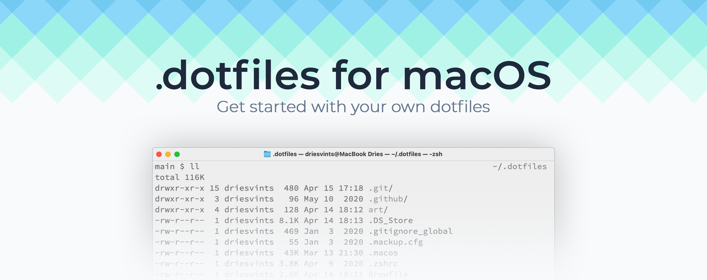

<p align="center"></p>

## Introduction

This repository serves as my way to help me setup and maintain my Mac. It takes the effort out of installing everything manually. Everything needed to install my preferred setup of macOS is detailed in this readme. Feel free to explore, learn and copy parts for your own dotfiles. Enjoy!

📖 - [Read the blog post](https://driesvints.com/blog/getting-started-with-dotfiles)  
📺 - [Watch the screencast on Laracasts](https://laracasts.com/series/guest-spotlight/episodes/1)  
💡 - [Learn how to build your own dotfiles](https://github.com/driesvints/dotfiles#your-own-dotfiles)

If you find this repo useful, [consider sponsoring me](https://github.com/sponsors/driesvints) (a little bit)! ❤️ 

## A Fresh macOS Setup

These instructions are for setting up new Mac devices. Instead, if you want to get started building your own dotfiles, you can [find those instructions below](#your-own-dotfiles).

### Backup your data

If you're migrating from an existing Mac, you should first make sure to backup all of your existing data. Go through the checklist below to make sure you didn't forget anything before you migrate.

- Did you remember to save all important documents from non-iCloud directories?
- Do you have a current backup of app preferences and other files not stored in this repository?

### Setting up your Mac

After backing up your old Mac you may now follow these install instructions to setup a new one.

1. Update macOS to the latest version through system preferences
2. Setup an SSH key by using one of the two following methods  
   2.1. If you use 1Password, install it with the 1Password [SSH agent](https://developer.1password.com/docs/ssh/get-started/#step-3-turn-on-the-1password-ssh-agent) and sync your SSH keys locally.  
   2.2. Otherwise [generate a new public and private SSH key](https://docs.github.com/en/github/authenticating-to-github/generating-a-new-ssh-key-and-adding-it-to-the-ssh-agent) by running:

   ```zsh
   curl https://raw.githubusercontent.com/driesvints/dotfiles/HEAD/ssh.sh | sh -s "<your-email-address>"
   ```

3. Clone this repo to `~/.dotfiles` with:

    ```zsh
    git clone git@github.com:driesvints/dotfiles.git ~/.dotfiles
    ```

4. Run the installation with:

    ```zsh
    cd ~/.dotfiles && ./fresh.sh
    ```

5. Restart your computer to finalize the process

Local development runs in online Orbs by [Amp Code](https://ampcode.com). These dotfiles install desktop apps, Git, and settings tools; they do not install PHP, Node, databases, or local project setup scripts.

Your Mac is now ready to use!

> 💡 You can use a different location than `~/.dotfiles` if you want. Make sure you also update the references in the [`.zshrc`](./.zshrc#L2) and [`fresh.sh`](./fresh.sh#L20) files.

### Git and SSH configuration

The `.gitconfig` and `ssh/config` files are versioned here. `fresh.sh` links them to `~/.gitconfig` and `~/.ssh/config`. You can also install them independently:

```sh
./install-configs.sh
```

The installer preserves existing configuration in adjacent `.before-dotfiles.*` files. Re-running it leaves correct links alone. Git and SSH configuration is managed directly by these links.

Personal Git identity (name, email, and public SSH signing key) lives only in `~/.gitconfig.local`, which is optionally included and never tracked here. On a new Mac, configure it locally:

```sh
git config --file ~/.gitconfig.local user.name "Your Name"
git config --file ~/.gitconfig.local user.email "you@example.com"
git config --file ~/.gitconfig.local user.signingkey "ssh-ed25519 YOUR_PUBLIC_SIGNING_KEY"
```

SSH configuration contains general defaults and the 1Password agent socket path. Private keys, passwords, and tokens are not stored in this repository. On a new Mac, enable the SSH agent and Git signing integration in 1Password; restore keys through 1Password or another secure method.

### Cleaning your old Mac (optionally)

After you've set up your new Mac you may want to wipe and clean install your old Mac. Follow [this article](https://support.apple.com/guide/mac-help/erase-and-reinstall-macos-mh27903/mac) to do that. Remember to [backup your data](#backup-your-data) first!

## Your Own Dotfiles

**Please note that the instructions below assume you already have set up Oh My Zsh so make sure to first [install Oh My Zsh](https://github.com/robbyrussell/oh-my-zsh#getting-started) before you continue.**

If you want to start with your own dotfiles from this setup, it's pretty easy to do so. First of all you'll need to fork this repo. After that you can tweak it the way you want.

Check out the [`Brewfile`](./Brewfile) file and adjust the apps you want to install for your machine. Use [their search page](https://formulae.brew.sh/cask/) to check if the app you want to install is available.

Check out the [`aliases.zsh`](./aliases.zsh) file and add your own aliases. If you need to tweak your `$PATH` check out the [`path.zsh`](./path.zsh) file. These files get loaded in because the `$ZSH_CUSTOM` setting points to the `.dotfiles` directory. You can adjust the [`.zshrc`](./.zshrc) file to your liking to tweak your Oh My Zsh setup. More info about how to customize Oh My Zsh can be found [here](https://github.com/robbyrussell/oh-my-zsh/wiki/Customization).

Application and macOS preferences are stored locally. These dotfiles restore the configuration tracked in this repository; use a separate machine backup to restore other local app settings and files.

You can tweak the shell theme, the Oh My Zsh settings and much more. Go through the files in this repo and tweak everything to your liking.

Enjoy your own Dotfiles!

## Thanks To...

I first got the idea for starting this project by visiting the [GitHub does dotfiles](https://dotfiles.github.io/) project. Both [Zach Holman](https://github.com/holman/dotfiles) and [Mathias Bynens](https://github.com/mathiasbynens/dotfiles) were great sources of inspiration. [Sourabh Bajaj](https://twitter.com/sb2nov/)'s [Mac OS X Setup Guide](http://sourabhbajaj.com/mac-setup/) proved to be invaluable (note: I removed this from my dotfiles in the meantime). Thanks to [@subnixr](https://github.com/subnixr) for [his awesome Zsh theme](https://github.com/subnixr/minimal)! Thanks to [Caneco](https://twitter.com/caneco) for the header in this readme. And lastly, I'd like to thank [Emma Fabre](https://twitter.com/anahkiasen) for [her excellent presentation on Homebrew](https://speakerdeck.com/anahkiasen/a-storm-homebrewin) which made me migrate a lot to a [`Brewfile`](./Brewfile).

In general, I'd like to thank every single one who open-sources their dotfiles for their effort to contribute something to the open-source community.
